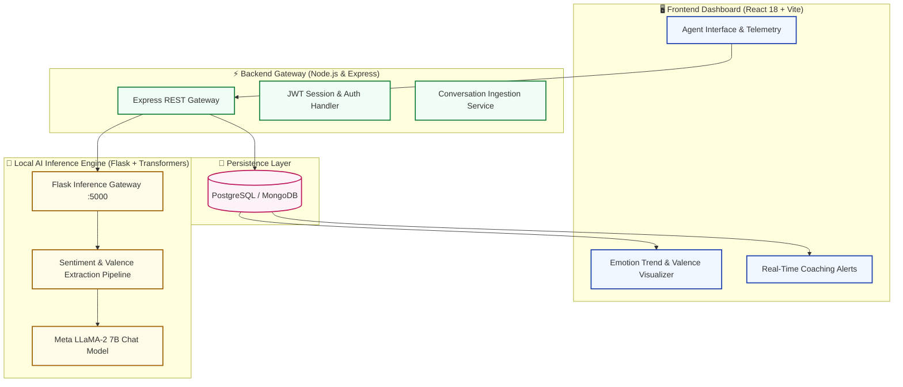

# Dialmate — Emotional Intelligence & Conversation Telemetry Platform

<div align="center">

[](Frontend/)
[]()
[]()
[]()
[]()

**DialMate AI • Intuitive emotional telemetry and real-time conversation analytics for business communication.**

</div>

---

## 📌 Executive Overview

**Dialmate** is a conversational analytics platform designed to capture, analyze, and visualize emotional trends from voice and textual customer interactions. By combining local, privacy-preserving LLM inference (LLaMA-2 7B) with real-time sentiment extraction and an intuitive dashboard, Dialmate empowers teams to track emotional valence, detect escalation patterns, and surface coaching suggestions.

---

## 🏗️ Full-Stack System Architecture



---

## ✨ Core Features

1. **Local Privacy-Preserving Inference**: Host and execute LLaMA-2 locally via PyTorch and Hugging Face Transformers, ensuring sensitive audio/chat transcripts never leave your infrastructure.
2. **Emotional Telemetry & Valence Scoring**: Classify conversation tone into structured emotional dimensions (Confidence, Hesitation, Frustration, Urgency).
3. **Interactive React Dashboard**: Visual analytics visualizing emotional trajectories across single calls or multi-week customer interactions.
4. **Automated Feedback & Alerts**: Real-time reminders when escalation thresholds or negative customer trends are breached.

---

## 🚀 Setup & Deployment

### 1. Local LLaMA-2 Inference Engine (Python)

```bash
# Set up Python environment
python -m venv llama_env
source llama_env/bin/activate  # On Windows: llama_env\Scripts\activate

# Install PyTorch with CUDA support (GPU recommended)
pip install transformers torch torchvision torchaudio --index-url https://download.pytorch.org/whl/cu118
pip install flask

# Launch the inference service
python llama_api.py
```

### 2. Frontend Dashboard (React + Vite)

```bash
cd Frontend
npm install
npm run dev
```

The frontend dashboard will be available at `http://localhost:5173`.

---

## 📬 Contact & Commercial Inquiries

- **Company**: DialMate AI
- **Website**: [dialmateai.com](https://dialmateai.com)
- **Founder**: Sayan Bhattacharya ([sayanpm17@gmail.com](mailto:sayanpm17@gmail.com))
- **LinkedIn**: [linkedin.com/in/snbhattacharya5](https://www.linkedin.com/in/snbhattacharya5/)
